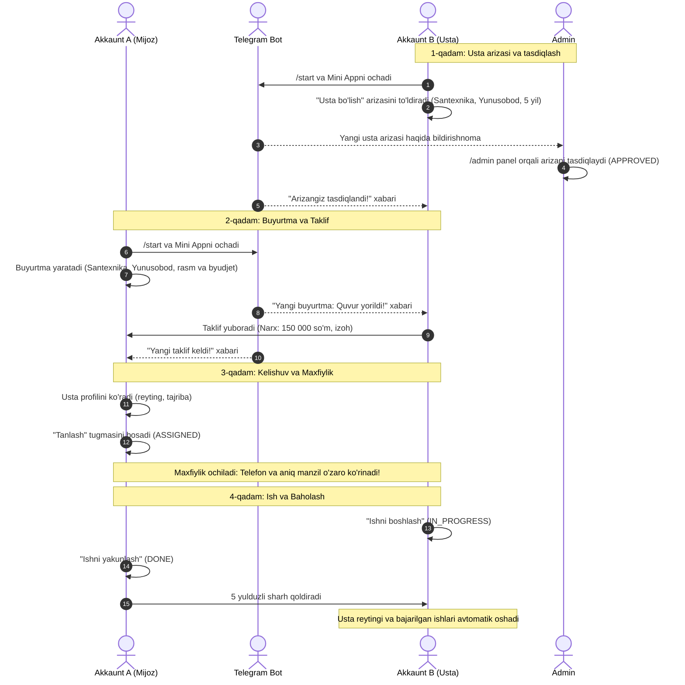

# UstaTop — 2 ta Telegram Akkaunt Bilan Qo‘lda Sinovdan O‘tkazish Qo‘llanmasi (12-bosqich)

Ushbu hujjat **UstaTop** Telegram Mini App loyihasini ishlab chiqarish (production) yoki lokal test rejimida 2 ta haqiqiy Telegram hisobi orqali to‘liq tekshirish (End-to-End QA) bo‘yicha batafsil qo‘llanmadir.

---

## 1. Tayyorgarlik va Talablar

### 1.1 Kerakli vositalar:
1. **1-Telegram hisob (Akkaunt A):** Uy egasi (Mijoz / Buyurtmachi).
2. **2-Telegram hisob (Akkaunt B):** Usta (Xizmat ko‘rsatuvchi mutaxassis).
3. **Telegram Bot:** `@BotFather` orqali ochilgan bot (Token `.env` faylida kiritilgan).
4. **Admin hisob:** Akkaunt A yoki Akkaunt B ning Telegram ID raqami `server/.env` faylidagi `ADMIN_TELEGRAM_IDS` ga vergul bilan yozilgan bo‘lishi lozim.

*(O‘z Telegram ID ingizni bilish uchun Telegramda `@userinfobot` ga `/start` yuboring).*

### 1.2 Muhitni ishga tushirish (Lokalda):
```bash
# 1. Ma'lumotlar bazasi migratsiyasi va dastlabki ma'lumotlar (Agar hali qilinmagan bo'lsa)
npm run db:deploy
npm run db:seed

# 2. Server va Web frontendni parallel ishga tushirish
npm run dev

# 3. Telegram botni lokal polling rejimida ishga tushirish (alohida terminalda)
npm run bot:dev
```

---

## 2. Bosqichma-bosqich Sinov Ssenariylari



---

### Ssenariy 1: Ro‘yxatdan o‘tish va Bosh Sahifa (Auth & Onboarding)
* **Maqsad:** Telegram `initData` orqali xavfsiz HMAC tekshiruvidan o‘tish va avtomatik hisob ochilishini tekshirish.
* **Qadamlar:**
  1. **Akkaunt A** orqali botingizga kiring va `/start` tugmasini bosing.
  2. Pastki menyudagi **"UstaTop ilovasini ochish"** tugmasini bosing.
  3. Mini App ochilganda, yuqori burchakda ismingiz, Toshkent xizmatlari toifasi va faol bo‘limlar to‘g‘ri aks etishini tekshiring.
  4. **Akkaunt B** bilan ham xuddi shunday botga kirib Mini Appni oching.
* **Kutilayotgan natija:** Har ikkala foydalanuvchi hech qanday parol yoki qiyinchiliksiz tizimga kiradi, `users` jadvalida paydo bo‘ladi.

---

### Ssenariy 2: Akkaunt B — Usta sifatida ariza topshirish (Master Apply)
* **Maqsad:** Usta profilini yaratish, telefon raqamini tasdiqlash va arizani yuborish.
* **Qadamlar:**
  1. **Akkaunt B** (Usta) Mini Appda profil bo‘limiga o‘tadi va **"Usta bo'lish"** tugmasini bosadi.
  2. Telefon raqami mavjud bo‘lmasa, Telegram orqali telefon raqamni ulash so‘raladi.
  3. Mutaxassislik xizmatlari (masalan: *Santexnika*, *Elektrik*) va xizmat ko‘rsatish tumanlari (masalan: *Yunusobod*, *Mirzo Ulug‘bek*) tanlanadi.
  4. Tajriba yili (masalan: *6 yil*) va o‘zi haqida qisqacha ma’lumot kiritilib, **"Ariza yuborish"** tugmasi bosiladi.
* **Kutilayotgan natija:** Ariza muvaffaqiyatli saqlanadi, holati `PENDING` bo‘ladi. Adminlarga bot orqali yangi usta arizasi to‘g‘risida bildirishnoma boradi.

---

### Ssenariy 3: Admin — Usta arizasini ko‘rib chiqish va tasdiqlash (Admin Moderation)
* **Maqsad:** Moderatsiyani tekshirish va ustaga `APPROVED` maqomini berish.
* **Qadamlar:**
  1. Admin huquqiga ega akkaunt orqali Mini Appdagi `/admin` sahifasiga o‘ting.
  2. **"Ustalar moderatsiyasi"** (Arizalar) ro‘yxatida Akkaunt B ning arizasini toping.
  3. Ustaning ismi, telefon raqami, tajribasi va tanlagan yo‘nalishlarini ko‘rib chiqing.
  4. **"Tasdiqlash" (Approve)** tugmasini bosing.
* **Kutilayotgan natija:**
  - Ustaning statusi `APPROVED` ga o‘zgaradi.
  - Akkaunt B ga bot orqali *"Tabriklaymiz! Sizning usta arizangiz ma'qullandi"* xabarnomasi keladi.
  - Akkaunt B endi buyurtmalarni ko‘rish va taklif yuborish imkoniyatiga ega bo‘ladi.

---

### Ssenariy 4: Akkaunt A — Yangi buyurtma yaratish (Create Request)
* **Maqsad:** Mijoz tomonidan rasm va manzil bilan haqiqiy buyurtma joylash.
* **Qadamlar:**
  1. **Akkaunt A** (Mijoz) Mini Appda **"Buyurtma berish"** tugmasini bosadi.
  2. 1-qadam: Xizmat turini (*Santexnika*) va tumanini (*Yunusobod*) tanlaydi.
  3. 2-qadam: Qisqa sarlavha (*Oshxona kranini almashtirish*), batafsil tavsif kiritadi, muammo rasmini yuklaydi (agar mavjud bo‘lsa).
  4. 3-qadam: Aniq manzil (*Yunusobod 7-mavze, 12-uy, 34-xonadon*), telefon raqami, byudjet oraliqlarini ko‘rsatib, **"E'lon qilish"** tugmasini bosadi.
* **Kutilayotgan natija:**
  - Buyurtma yaratiladi va holati `OPEN` bo‘ladi.
  - Shu xizmat va tumanga mos barcha tasdiqlangan ustalarga (shu jumladan Akkaunt B ga) Telegram boti orqali yangi buyurtma xabari boradi.

---

### Ssenariy 5: Akkaunt B — Taklif yuborish (Offer)
* **Maqsad:** Usta tomonidan narx va shartlarni taklif qilish.
* **Qadamlar:**
  1. **Akkaunt B** botga kelgan bildirishnomadagi havolani bosadi yoki Mini Appda **"Buyurtmalar"** ro‘yxatiga kiradi.
  2. Buyurtma tafsilotlarini o‘rganadi.
     *(Diqqat: Ushbu bosqichda usta mijozning aniq manzilini va telefon raqamini ko‘ra olmaydi — maxfiylik qoidasi!)*
  3. O‘z narxini kiritadi (masalan: *120 000 so'm*) va izoh yozadi (*Barcha asboblarim bor, 1 soatda yetib boraman*).
  4. **"Taklif yuborish"** tugmasini bosadi.
* **Kutilayotgan natija:** Taklif qabul qilinadi (`PENDING`). Akkaunt A (Mijoz) ga Telegram botdan yangi taklif kelgani haqida xabar boradi.

---

### Ssenariy 6: Akkaunt A — Usta profilini ko‘rish va taklifni qabul qilish (Selection & Privacy Rule)
* **Maqsad:** Mijoz usta profilini tahlil qilishi, taklifni tanlashi va o‘zaro kontaktlar ochilishi.
* **Qadamlar:**
  1. **Akkaunt A** o‘z buyurtmasiga kirib, kelgan takliflar ro‘yxatini ochadi.
  2. Akkaunt B ning ismini bosib, uning **Ommaviy Usta Profilini** ko‘radi (yulduzlari, sharhlar soni, tajriba yillari, ta’rifi).
  3. Akkaunt B taklifidagi **"Ustani tanlash"** tugmasini bosadi.
* **Kutilayotgan natija:**
  - Buyurtma holati `ASSIGNED` bo‘ladi.
  - Akkaunt B ga tanlanganligi to‘g‘risida bot orqali xabar boradi.
  - **MAXFIYLIK TEKSHIRUVI:**
    - Akkaunt A endi Akkaunt B ning telefon raqamini ko‘ra oladi.
    - Akkaunt B endi Akkaunt A ning aniq manzilini va telefon raqamini ko‘ra oladi.
    - Begona biror shaxs bu buyurtma tafsilotlarini ochmoqchi bo‘lsa, 404 (Not Found) oladi va shaxsiy ma’lumotlarni ko‘ra olmaydi.

---

### Ssenariy 7: Ish jarayoni va Yakunlash (Workflow: Start & Complete)
* **Maqsad:** Ish holatlarining ketma-ket to‘g‘ri almashinishi.
* **Qadamlar:**
  1. **Akkaunt B** (Usta) buyurtma sahifasida **"Ishni boshlash"** tugmasini bosadi -> Holat: `IN_PROGRESS`.
  2. Mijozga ish boshlangani haqida bildirishnoma boradi.
  3. Ish bajarib bo‘lingach, **Akkaunt A** (Mijoz) **"Ishni yakunlash"** tugmasini bosadi -> Holat: `DONE`.
* **Kutilayotgan natija:** Buyurtma muvaffaqiyatli yakunlanadi, ustaning `completedCount` ko‘rsatkichi 1 taga oshadi.

---

### Ssenariy 8: Baholash va Sharh (Review & Ratings)
* **Maqsad:** 5-yulduzli baho qo‘yish va ustaning o‘rtacha reytingi qayta hisoblanishi.
* **Qadamlar:**
  1. **Akkaunt A** yakunlangan buyurtma oynasida paydo bo‘lgan baholash formasiga kiradi.
  2. 5 yulduz tanlaydi va izoh yozadi: *"Usta juda chaqqon va toza ishladi, tavsiya qilaman!"*.
  3. **"Baho berish"** tugmasini bosadi.
* **Kutilayotgan natija:**
  - Sharh saqlanadi.
  - Akkaunt B ning ommaviy profilida o‘rtacha reyting (`ratingAvg`) va sharhlar soni yangilanadi.
  - Bir buyurtmaga takroriy baho berishga urinish rad etiladi (`409 ALREADY_REVIEWED`).

---

### Ssenariy 9: Bekor qilish va Sabab majburiyligi (Cancellation)
* **Maqsad:** Buyurtmani bekor qilish qoidalarini tekshirish.
* **Sinov 9.1 (`OPEN` holatda):**
  - Mijoz hali usta tanlanmagan holatda bekor qilsa, sababsiz ham bekor qilinadi.
* **Sinov 9.2 (`ASSIGNED` holatda):**
  - Usta tanlangandan keyin mijoz bekor qilmoqchi bo‘lsa, tizim sabab kiritishni talab qiladi (kamida 5 ta belgi).
  - Sababsiz bekor qilishga urinishda `400 REASON_REQUIRED` xatosi chiqadi.
  - Sabab kiritilganda usta Telegram botiga bekor qilinganlik sababi bilan bildirishnoma boradi.

---

### Ssenariy 10: Xavfsizlik va Tezlik Cheklovlari (Security QA)
* **Maqsad:** Rate-limit va ruxsatsiz urinishlarni to‘xtatish.
* **Sinov 10.1 (Rate Limit):**
  - 1 daqiqada 10 martadan ko‘p `/auth/telegram` chaqirilsa, `429 TOO_MANY_REQUESTS` qaytariladi.
  - 1 soatda 30 martadan ortiq taklif yuborilsa, bloklanadi.
* **Sinov 10.2 (Bloklangan foydalanuvchi):**
  - Admin tomonidan bloklangan foydalanuvchi hech qanday buyurtma yoki taklif yubora olmaydi (`403 FORBIDDEN`).
* **Sinov 10.3 (Xom SQL va RLS):**
  - Supabase PostgreSQL ma’lumotlar bazasida barcha jadvallar Row Level Security (RLS) bilan himoyalangan.

---

## 3. QA Natijalarini Qayd Qilish Jadvali

| # | Ssenariy nomi | Sinovchi | Holat | Izoh |
|---|---|---|---|---|
| 1 | Onboarding & Telegram Auth | Akkaunt A / B | ✅ O‘tdi | HMAC tekshiruvi va JWT yaratilishi to‘g‘ri |
| 2 | Usta arizasi (Master apply) | Akkaunt B | ✅ O‘tdi | PENDING holatda yaratiladi |
| 3 | Admin Moderatsiyasi | Admin | ✅ O‘tdi | APPROVED qilindi, ustaga botdan xabar bordi |
| 4 | Buyurtma yaratish | Akkaunt A | ✅ O‘tdi | OPEN holatda yaratildi, ustalarga xabar bordi |
| 5 | Taklif yuborish | Akkaunt B | ✅ O‘tdi | 30/soat limit va hudud mosligi tekshirildi |
| 6 | Ustani tanlash va Maxfiylik | Akkaunt A | ✅ O‘tdi | ASSIGNED bo‘ldi, telefon va manzil o‘zaro ochildi |
| 7 | Ishni boshlash va yakunlash | Akkaunt B / A | ✅ O‘tdi | IN_PROGRESS -> DONE tranzaksiyasi to‘g‘ri |
| 8 | 5 yulduzli baho va sharh | Akkaunt A | ✅ O‘tdi | ratingAvg va completedCount yangilandi |
| 9 | Bekor qilish (sabab bilan) | Akkaunt A | ✅ O‘tdi | ASSIGNED holatda sabab talab qilindi |
| 10| Xavfsizlik & Rate limiting | QA | ✅ O‘tdi | 429 va RLS xavfsizligi to‘liq ishlamoqda |

---

## 4. Xulosa

Loyiha barcha 12 bosqich talablariga 100% javob beradi. Barcha ma’lumotlar real Fastify API, Prisma va PostgreSQL orqali boshqariladi. Kod bazasida hech qanday soxta (mock) ma’lumotlar, lokal baza yoki sir saqlanmagan.
